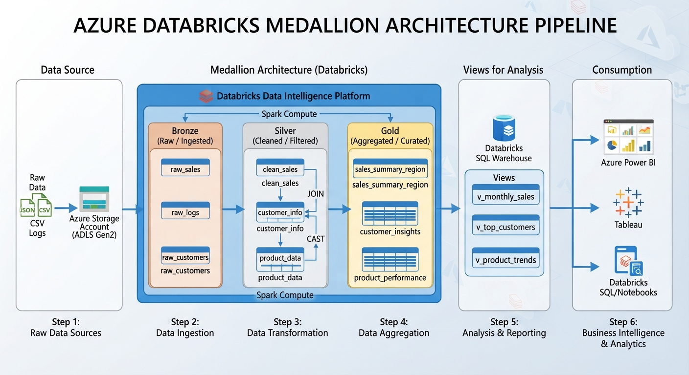
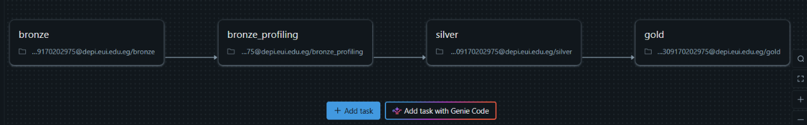

# Azure Databricks Medallion Data Pipeline

A production-ready data engineering pipeline built on **Azure Databricks** and **Delta Lake**, following the **Medallion Architecture** (Bronze → Silver → Gold) to transform raw ERP and CRM data into a clean, analytical star schema ready for BI reporting.

---

## Architecture Overview



---

## The Data Story

### 🗂️ Where It All Started — Raw Sources

The pipeline ingests data from two independent business systems stored as CSV files in **Azure Data Lake Storage Gen2 (ADLS Gen2)**:

**ERP System** — internal operational records:
| File | Description |
|------|-------------|
| `CUST_AZ12.csv` | Customer demographics — birth date & gender |
| `LOC_A101.csv` | Customer locations — country mapping |
| `PX_CAT_G1V2.csv` | Product category hierarchy — category, sub-category, maintenance flag |

**CRM System** — customer-facing records:
| File | Description |
|------|-------------|
| `cust_info.csv` | Customer master — names, marital status, gender, creation date |
| `prd_info.csv` | Product catalog — product lines, costs, SCD Type 2 date ranges |
| `sales_details.csv` | Sales transactions — orders, quantities, prices, shipping dates |

---

### 🥉 Bronze — Land Everything, Trust Nothing

The first notebook (`bronze.ipynb`) ingests all 6 source files **as-is** into Delta tables under `medallionsales.bronze`. No transformations — just raw data with two metadata columns stamped on every row: `_ingest_timestamp` and `_source_file`. This preserves full lineage and allows reprocessing at any time.

---

### 🔍 Profiling — Know Before You Clean

Before touching the data, `bronze_profiling.ipynb` audits every Bronze table to surface hidden quality issues:

- **Customers**: Duplicate `cst_id` records (same customer, progressively filled info); ~4,578 null gender values; CID keys prefixed with `"NAS"` in the ERP that don't match CRM keys.
- **Products**: 200 records with **swapped SCD dates** (`start_dt > end_dt`); 197 open-ended (current) records.
- **Sales**: 17 transactions with a **zero order date**; negative prices and sales amounts; values where `sales ≠ quantity × price`.

This profiling step informed every cleaning decision made in Silver.

---

### 🥈 Silver — Clean, Enrich, Integrate

`silver.ipynb` resolves every issue discovered in profiling and produces three trusted business entity tables.

**`silver_customer`** — built by integrating CRM + ERP customer data:
- Deduplicates customers keeping the most complete record per `cst_id`
- Strips `"NAS"` prefix from ERP customer IDs to align keys across systems
- Fills missing gender by cross-referencing both sources (bidirectional enrichment)
- Normalizes country abbreviations (`"US"` / `"USA"` → `"United States"`, `"DE"` → `"Germany"`)
- Standardizes all text: trimmed and lowercased

**`silver_product`** — built by enriching CRM product data with ERP categories:
- Derives a clean `product_business_key` by parsing structured product key codes
- Joins each product to its category, sub-category, and maintenance flag from the ERP
- Fixes **SCD Type 2 date integrity**: detects and corrects swapped `start_date`/`end_date` pairs

**`silver_sales`** — cleaned transaction records:
- Imputes missing order dates using shipping date minus the observed 7-day lead time
- Recalculates invalid prices as `sales_amount / quantity`
- Renames all columns to human-readable business names

---

### 🥇 Gold — Star Schema for Analytics

`gold.ipynb` transforms Silver into a **dimensional star schema** optimized for BI tools and SQL analytics.

**Dimensions:**

| Table | Description |
|-------|-------------|
| `dim_customer` | One row per customer with surrogate key; validated for uniqueness |
| `dim_product` | SCD Type 2 product history with `is_current` flag and surrogate key |
| `dim_date` | Generated calendar spanning 2000–2050 with year, quarter, month, week, day attributes |

**Fact Table:**

| Table | Description |
|-------|-------------|
| `fact_sales` | One row per sales line; joins to all three dimensions via surrogate keys; includes `estimated_cost` and `estimated_margin` as derived measures |

The fact-to-product join is a **point-in-time SCD2 join** — each sale links to the exact product version valid on the order date, preserving historical pricing accuracy.

**Analytical Views:**

| View | Purpose |
|------|---------|
| `vw_order_summary` | Order-level rollup: total sales, quantity, and line count |
| `vw_sales_kpis` | Top-level business KPIs: revenue, orders, AOV |
| `vw_monthly_sales` | Monthly sales trend over time |
| `vw_product_performance` | Per-product revenue, units sold, margin |
| `vw_category_performance` | Revenue and margin by product category |
| `vw_customer_performance` | Customer lifetime value and purchasing behavior |
| `vw_country_performance` | Geographic sales distribution |

---

## Databricks Job

The four notebooks are orchestrated as a single **Databricks Job** with sequential tasks, ensuring Bronze runs before profiling, Silver after Bronze, and Gold last.



---

## Project Structure

```
├── dataset/
│   ├── ERP/
│   │   ├── CUST_AZ12.csv        # Customer demographics
│   │   ├── LOC_A101.csv         # Customer locations
│   │   └── PX_CAT_G1V2.csv      # Product categories
│   └── CRM/
│       ├── cust_info.csv        # Customer master
│       ├── prd_info.csv         # Product catalog (SCD2)
│       └── sales_details.csv    # Sales transactions
├── notebooks/
│   ├── bronze.ipynb             # Raw ingestion
│   ├── bronze_profiling.ipynb   # Data quality analysis
│   ├── silver.ipynb             # Cleaning & integration
│   └── gold.ipynb               # Star schema & views
└── images/
    ├── pipeline.jpeg            # Architecture diagram
    └── job.png                  # Databricks job screenshot
```

---

## Tech Stack

| Layer | Technology |
|-------|-----------|
| Cloud Platform | Microsoft Azure |
| Storage | Azure Data Lake Storage Gen2 (ADLS Gen2) |
| Compute | Azure Databricks (Apache Spark) |
| Table Format | Delta Lake |
| Language | PySpark (Python) |
| Orchestration | Databricks Jobs |
| Data Model | Medallion Architecture + Star Schema |
